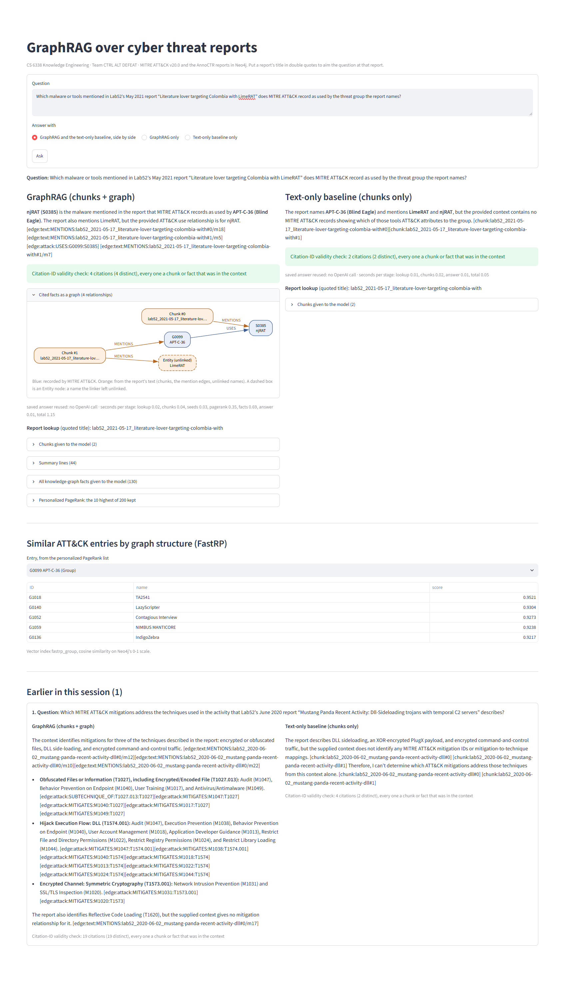

# CTRL ALT DEFEAT — GraphRAG over cyber threat reports

Term project for CS 6338 Knowledge Engineering, Angelo State University. Team CTRL ALT DEFEAT: Shane Waldrop.

The system answers questions about cyber threat reports. A knowledge graph in Neo4j joins MITRE ATT&CK v20.0 (Enterprise) with the AnnoCTR threat reports. A language model answers from retrieved report text plus the graph, and every answer cites the report chunks and graph edges it used. The same pipeline without the graph is the text-only baseline.

**Status:** built and evaluated; the measured results are summarized in `results/README.md`, and the final technical report, with the scripts behind its numbers, is in `docs/final/`. Every stage runs: ATT&CK loading, extraction, linking and loading, graph analytics, scoring, and question answering with and without the graph, from Command Prompt or from a chat page. Extraction, linking and scoring take one report or a whole split (`--split dev`, `--split test`). A question that names a report by its title is answered from that report, with summary lines that count the report's links in ATT&CK. The benchmark (gold triples, evaluation questions) and the scorer are in place, `evaluate.py` answers the 24 benchmark questions with both systems and measures them: answer accuracy, operations (citation validity, tokens, cost, seconds per stage), extraction beside an exact-name baseline, RAGAS scores from a judge model, and a blind human rating.

## Repository layout

| Path | What it is |
|---|---|
| `schemas.py` | every node label, relationship type and property name, defined once and imported everywhere else |
| `schema.cypher` | one uniqueness constraint per node label, the vector index for chunk embeddings, and three vector indexes for FastRP vectors (Technique, Group, Software) |
| `db.py` | the Neo4j connection, configured from `.env`; every data query names its Cypher version |
| `datafiles.py` | where the data files live, and the SHA-256 check |
| `apply_schema.py` | applies `schema.cypher` and lists the constraints and indexes in place |
| `load_attack.py` | MITRE ATT&CK v20.0: STIX JSON → RDF with rdflib (saved as `out/attack-v20.ttl`) → Neo4j, with count checks |
| `analytics.cypher` | the GDS (Graph Data Science) queries: one undirected projection of ATT&CK alone, then PageRank, Louvain communities and FastRP vectors, each run with one thread |
| `enrich.py` | runs `analytics.cypher` once, saves the results under `analytics/`, writes them onto the ATT&CK nodes and checks the FastRP vector indexes; later runs load the saved files |
| `annoctr.py` | the AnnoCTR reports: text, chunks (4,000 characters, 400 shared) and the experts' ATT&CK labels |
| `llm.py` | every OpenAI call (gpt-6-sol, text-embedding-3-small), saved under `replies/` and reused on reruns |
| `extract.py` | the model lists techniques, tactics, groups, software and "uses" relations in each chunk, each with its evidence sentence; code checks every item and counts each reason for dropping one; a reply cut off at 4,000 tokens is asked again once at 8,000; a run stops after 3 chunks in a row without a complete reply and ends with its tokens and their cost at list price |
| `link.py` | links each mention to ATT&CK (exact name, tie-break rules, then embedding similarity above a threshold, for mentions whose model confidence reaches a cut-off) and loads the report, its chunks and the links into Neo4j |
| `calibrate.py` | sets link.py's threshold and cut-off on the 16 dev reports by the rule written before the dev run, from saved replies only; writes `results/calibration_dev.csv` |
| `rag.py` | answers a question from report chunks plus the graph, citing `[chunk:…]` and `[edge:…]`: finds the reports the question names by title, takes their chunks most similar to the question, ranks the graph around the entries they mention with personalized PageRank (scores saved under `replies/pagerank`), and adds summary lines counted in Cypher (for each ATT&CK entry linked to the report's entries, how many it links to); prints the seconds each stage took; the same question without the graph is the baseline |
| `app.py` | the chat page (Streamlit): a question answered by GraphRAG beside the text-only baseline, with the citation check, the cited facts drawn as a graph, the chunks, the summary lines, the facts, ATT&CK entries similar by graph structure (FastRP), and the session's earlier questions |
| `.streamlit/config.toml` | the chat page's settings: this computer only, no email prompt, no usage statistics |
| `models.py` | Pydantic data models for the graph (ATT&CK entries, relationships, chunks) and for the question-answering payloads (`QueryRequest`, `QueryResponse`); the extraction reply models are in `extract.py` |
| `gold.py` | writes the benchmark: the experts' facts as gold triples, and 24 multi-hop questions with answers computed from those facts and ATT&CK; `--neo4j` recomputes every answer with Cypher in Neo4j |
| `score.py` | precision, recall and F1 of the system's facts in Neo4j against the gold triples, at sub-technique and parent-technique level |
| `evaluate.py` | the evaluation: `answers` asks the 24 benchmark questions with GraphRAG and with the text-only baseline, exactly as `rag.py` asks, and saves both answers with their context, citation check, tokens, cost at list price and seconds in `results/benchmark_answers.json`; a run stops after 3 questions in a row without an answer. `sheet` writes the blind rating sheet (`results/rating_sheet.html`: each question's two answers as A and B in an order drawn with a fixed seed, citations replaced by numbers, the cited texts listed in one format for both systems) and its key (`results/rating_key.json`); `ratings` checks the 144 scores saved from the sheet, joins them to the key and writes `results/human_ratings.csv`; `accuracy` scores the ATT&CK IDs each answer names against the question's answer IDs; `operations` gives citation-ID validity, tokens, cost and the seconds of each stage; `extraction` scores the test split's extraction and linking beside an exact-name baseline; `ragas` gets RAGAS Faithfulness, AnswerRelevancy and ContextRecall from the judge model; `hallucination` counts the statements the judge found unsupported by their context, from the saved verdicts; `intervals` gives 95% bootstrap intervals for the means and the GraphRAG-minus-baseline differences (questions resampled for answer measures, test reports for extraction) |
| `judge.py` | the RAGAS judge (gpt-6-astra, reasoning effort low, 16,000-token cap): a client that removes temperature from every request and saves every judge reply under `replies/ragas` for reruns, and the three metrics, one answer at a time |
| `benchmark/` | `gold_triples.json` and `eval_queries.json`, written by `gold.py` only (see `benchmark/README.md`) |
| `replies/` | saved model replies and embeddings (`extract`, `embeddings`, `answers`, `ollama`, `ragas`) and the PageRank scores each question used (`pagerank`); committing them makes every rerun identical |
| `results/` | tables computed from saved replies: the dev calibration table, the benchmark answers, the rating sheet and its key, the scores and the scores joined to the key, answer accuracy, operations, extraction against the baseline (overall and per report), RAGAS scores, the hallucination rate, the bootstrap intervals; `results/README.md` explains each file and gives the headline numbers |
| `analytics/` | the saved GDS results: PageRank score and community of every ATT&CK entry, FastRP vectors, and how they were computed |
| `data/` | the data files, their licences and their SHA-256 list (see `data/README.md`) |
| `scripts/` | `try_openai.py` and `check_setup.py`, the checks for a new machine; `check_summaries.py`, which compares rag.py's summary-line Cypher with the same count in Python; `try_ollama.py`, one report chunk through a local model |
| `tests/` | `pytest` tests |
| `docs/milestones/` | the proposal and design document (PDF and LaTeX sources) |

## What you need

| Item | Version used | Notes |
|---|---|---|
| Windows | 11 | The commands below are for Command Prompt (`cmd.exe`). |
| Python | 3.11 | From python.org. The project installs its packages into its own virtual environment. |
| Git | 2.51 | |
| Neo4j Desktop | 2.2 | One local instance running Neo4j 2026.09.0 with the APOC and Graph Data Science plugins. |
| OpenAI API key | | Models: gpt-6-sol (extraction and answers), text-embedding-3-small (vectors), gpt-6-astra (evaluation judge). |
| Ollama | 0.40 | Only for the local-model demonstration (`qwen3:4b`). |

Keep the repository and the virtual environment outside any folder that OneDrive syncs.

## Setup (Command Prompt)

1. Clone the repository and enter its folder:
   ```
   git clone https://github.com/Wittyusername12/ctrl-alt-defeat-graphrag.git
   cd ctrl-alt-defeat-graphrag
   ```
2. Create the virtual environment from Python 3.11. The path below is the python.org installer's default location; change it if Python 3.11 is installed elsewhere.
   ```
   %LOCALAPPDATA%\Programs\Python\Python311\python.exe -m venv %USERPROFILE%\.venvs\ctrl-alt-defeat-graphrag
   ```
3. Install the pinned packages into that environment (`requirements.txt` lists all 120 with exact versions):
   ```
   %USERPROFILE%\.venvs\ctrl-alt-defeat-graphrag\Scripts\python.exe -m pip install -r requirements.txt
   ```
4. Create `.env` from the template and paste the OpenAI key after `OPENAI_API_KEY=` (the Neo4j values come in step 6):
   ```
   copy .env.example .env
   notepad .env
   ```
5. Check the OpenAI connection (one short structured request and one embedding):
   ```
   %USERPROFILE%\.venvs\ctrl-alt-defeat-graphrag\Scripts\python.exe scripts\try_openai.py
   ```
6. In Neo4j Desktop, create a local instance running Neo4j 2026.09.0, install the APOC and Graph Data Science plugins on that instance, start it, and put its connection URI and password into `.env`.
7. Check Python, the packages, `.env`, Neo4j and its plugins, and the data files:
   ```
   %USERPROFILE%\.venvs\ctrl-alt-defeat-graphrag\Scripts\python.exe scripts\check_setup.py
   ```
   The last line reads `RESULT: OK` when everything is in place.

## Build the knowledge graph (Command Prompt, in the repository folder, with the Neo4j instance started)

8. Apply the schema (the constraints and the four vector indexes; running it again changes nothing):
   ```
   %USERPROFILE%\.venvs\ctrl-alt-defeat-graphrag\Scripts\python.exe apply_schema.py
   ```
9. Load MITRE ATT&CK v20.0: 1,785 nodes and 20,426 relationships. The script checks its counts at every stage and ends with `RESULT: OK` when they all match:
   ```
   %USERPROFILE%\.venvs\ctrl-alt-defeat-graphrag\Scripts\python.exe load_attack.py
   ```
   Then write the graph analytics onto the ATT&CK nodes: PageRank scores, Louvain communities and FastRP vectors. The first run computes them with GDS and saves them under `analytics/`; every later run, on any machine, loads the saved files, so the numbers stay the same:
   ```
   %USERPROFILE%\.venvs\ctrl-alt-defeat-graphrag\Scripts\python.exe enrich.py
   ```
10. Extract, link and load a report, then ask a question. With no report named, the scripts use the Phase 2 report `lab52_2020-06-02_mustang-panda-recent-activity-dll` (dev split); with no question, `rag.py` asks which ATT&CK mitigations address the techniques in that report. Saved replies are reused, so a rerun calls OpenAI only for what is new:
    ```
    %USERPROFILE%\.venvs\ctrl-alt-defeat-graphrag\Scripts\python.exe extract.py
    %USERPROFILE%\.venvs\ctrl-alt-defeat-graphrag\Scripts\python.exe link.py
    %USERPROFILE%\.venvs\ctrl-alt-defeat-graphrag\Scripts\python.exe rag.py
    ```
11. Extract, link, load and score a whole split. Changes are tried on the 16 dev reports; the 34 test reports are run once, after the calibration on dev. `extract.py` stops after 3 chunks in a row without a complete reply, and ends with the tokens of its new replies and their cost at list price; `link.py` gives each report a short summary:
    ```
    %USERPROFILE%\.venvs\ctrl-alt-defeat-graphrag\Scripts\python.exe extract.py --split dev
    %USERPROFILE%\.venvs\ctrl-alt-defeat-graphrag\Scripts\python.exe link.py --split dev
    %USERPROFILE%\.venvs\ctrl-alt-defeat-graphrag\Scripts\python.exe score.py --split dev
    ```
    `calibrate.py` recomputes the dev calibration from the saved replies alone (no OpenAI call, no Neo4j) and checks that `link.py` holds the chosen threshold and cut-off:
    ```
    %USERPROFILE%\.venvs\ctrl-alt-defeat-graphrag\Scripts\python.exe calibrate.py
    ```

## Ask questions (Command Prompt, in the repository folder, with the Neo4j instance started)

12. Check the summary lines: `check_summaries.py` runs rag.py's summary-line query in Neo4j and compares its rows with the same count done in Python from the ATT&CK file, for a hand-worked case and for every loaded report (no OpenAI call):
    ```
    %USERPROFILE%\.venvs\ctrl-alt-defeat-graphrag\Scripts\python.exe scripts\check_summaries.py
    ```
13. Ask a question in Command Prompt. Put a report's title in double quotes to aim the question at that report; with no question, `rag.py` asks the tracer question, which quotes the title of Lab52's June 2020 Mustang Panda report:
    ```
    %USERPROFILE%\.venvs\ctrl-alt-defeat-graphrag\Scripts\python.exe rag.py
    ```
14. Ask on the chat page. Streamlit serves the page at http://localhost:8501 and opens it in the browser; Ctrl+C in Command Prompt stops it:
    ```
    %USERPROFILE%\.venvs\ctrl-alt-defeat-graphrag\Scripts\python.exe -m streamlit run app.py
    ```
    Below each GraphRAG answer, the relationships and chunks it cites are drawn as a graph, read from Neo4j by their edge IDs (blue: recorded by ATT&CK; orange: from the report's text; a dashed box: a name the linker left unlinked). The session's earlier questions and answers stay on the page, newest first, until the browser tab is closed or reloaded. The page on 22 Oct 2026, answering benchmark question Q10 with GraphRAG (left) and the text-only baseline (right) after the tracer question, all from saved answers:

    
15. Local model (needs Ollama with `qwen3:4b` pulled): one report chunk through `qwen3:4b` with the extraction prompt and reply format, checked like the gpt-6-sol replies. On a laptop processor the chunk takes minutes; the reply is saved under `replies/ollama`, and a rerun reuses it without Ollama:
    ```
    %USERPROFILE%\.venvs\ctrl-alt-defeat-graphrag\Scripts\python.exe scripts\try_ollama.py
    ```

## Benchmark and scoring (Command Prompt, in the repository folder, with the Neo4j instance started)

16. Check the benchmark: `--check` rebuilds both benchmark files and compares them with the files in `benchmark/`; `--neo4j` also runs each question's Cypher query in Neo4j and compares its answer with the file's. Running `gold.py` with neither option rewrites both files from the data:
    ```
    %USERPROFILE%\.venvs\ctrl-alt-defeat-graphrag\Scripts\python.exe gold.py --neo4j
    ```
17. Score the system's facts in Neo4j against the gold triples, for named reports or for a whole split (`--split dev` or `--split test`):
    ```
    %USERPROFILE%\.venvs\ctrl-alt-defeat-graphrag\Scripts\python.exe score.py lab52_2020-06-02_mustang-panda-recent-activity-dll
    ```

## Evaluation (Command Prompt, in the repository folder, with the Neo4j instance started)

18. Answer the 24 benchmark questions with GraphRAG and with the text-only baseline. Saved answers are reused, so a rerun calls OpenAI only for what is new; question IDs (for example `Q01 Q02`) limit the run to those questions. The run stops after 3 questions in a row without an answer, and ends with the tokens and their cost at list price:
    ```
    %USERPROFILE%\.venvs\ctrl-alt-defeat-graphrag\Scripts\python.exe evaluate.py answers
    ```
19. Rate the 48 answers blind (no Neo4j or OpenAI needed). `evaluate.py sheet` writes the rating sheet from the saved answers (the repository holds the sheet already). Open the sheet in the browser, give every answer a score from 1 to 5 on Factuality, Completeness and Coherence, and press **Save scores**, which downloads `ratings.csv`; the page keeps the choices in the browser while you work. Then `evaluate.py ratings` takes the newest `ratings*.csv` from the Downloads folder (or a file named after the command), copies the file to `results\ratings.csv`, checks the 144 scores, joins them to the key and prints each system's mean scores:
    ```
    start results\rating_sheet.html
    %USERPROFILE%\.venvs\ctrl-alt-defeat-graphrag\Scripts\python.exe evaluate.py ratings
    ```
20. Measure the saved answers and the test split's extraction (no Neo4j or OpenAI needed): answer accuracy, operations, and extraction beside the exact-name baseline:
    ```
    %USERPROFILE%\.venvs\ctrl-alt-defeat-graphrag\Scripts\python.exe evaluate.py accuracy
    %USERPROFILE%\.venvs\ctrl-alt-defeat-graphrag\Scripts\python.exe evaluate.py operations
    %USERPROFILE%\.venvs\ctrl-alt-defeat-graphrag\Scripts\python.exe evaluate.py extraction
    ```
21. RAGAS scores from the judge model (OpenAI; saved judge replies are reused). Run the two-question trial first, then all 24 questions; a run stops after 3 answers in a row without a score, or once its new judge calls pass $40 at list price:
    ```
    %USERPROFILE%\.venvs\ctrl-alt-defeat-graphrag\Scripts\python.exe evaluate.py ragas Q01 Q02
    %USERPROFILE%\.venvs\ctrl-alt-defeat-graphrag\Scripts\python.exe evaluate.py ragas
    ```
22. The hallucination rate (from the saved judge verdicts) and the 95% bootstrap intervals (10,000 resamples, fixed seed), after steps 19–21 (no Neo4j or OpenAI needed):
    ```
    %USERPROFILE%\.venvs\ctrl-alt-defeat-graphrag\Scripts\python.exe evaluate.py hallucination
    %USERPROFILE%\.venvs\ctrl-alt-defeat-graphrag\Scripts\python.exe evaluate.py intervals
    ```

## Tests

```
%USERPROFILE%\.venvs\ctrl-alt-defeat-graphrag\Scripts\python.exe -m pytest
```

## Why RDF is built with rdflib, not n10s

`load_attack.py` turns ATT&CK's STIX file into RDF with rdflib and loads Neo4j from that RDF. The Neo4j plugin for RDF, n10s (neosemantics), is not used: the plugin list of Neo4j Desktop 2.2.1 offers APOC, Graph Data Science, Bloom and Gen AI but not n10s, and n10s versions are built for one Neo4j version each. The newest, n10s 2025.06.1 (tagged 29 May 2026), targets Neo4j 2025.06.2, and a 2025.12 line is in preparation; none targets Neo4j 2026.09, which this project runs (checked in the n10s repository's tags and `pom.xml` files, 19 Oct 2026).
